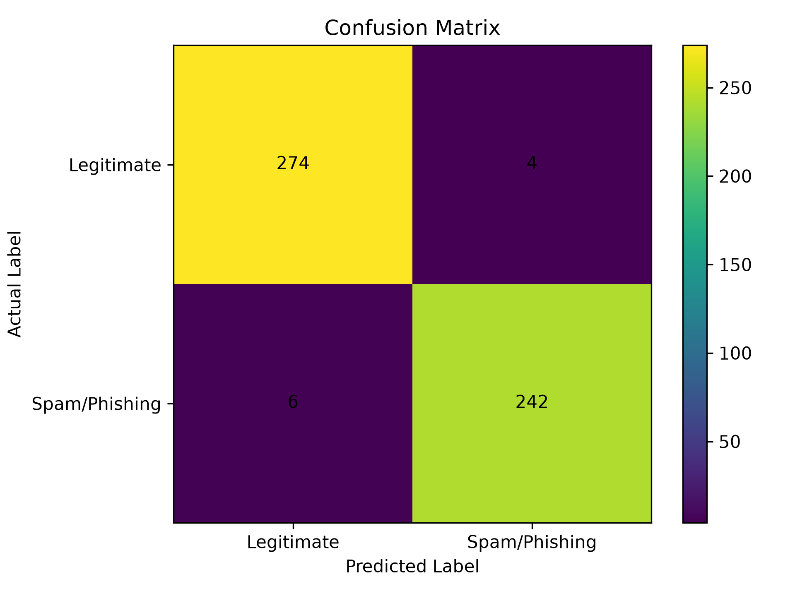
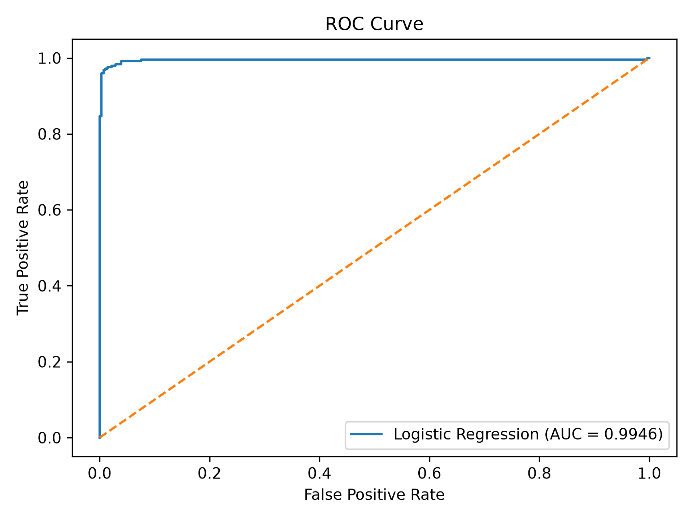

# 🛡️ PhishGuard AI
### AI-Powered Phishing Email Detection & Threat Analysis

PhishGuard AI is an intelligent email security system that combines Machine Learning and rule-based threat analysis to identify potential phishing and spam emails.

The system analyzes email content, URLs, sender information, and email headers to calculate a risk score and provide explainable security insights through an interactive web dashboard.

---

## 🚀 Key Features

- 🤖 **Machine Learning Detection:** TF-IDF feature extraction with Logistic Regression for email classification.
- 📊 **98.10% Accuracy:** Evaluated on the project's test dataset.
- 🔍 **Explainable AI:** Provides understandable explanations for detected threats.
- 🌐 **URL Intelligence:** Identifies suspicious URLs, IP-based links, shortened URLs, punycode, and suspicious keywords.
- 📧 **Sender Analysis:** Examines sender addresses and suspicious domain characteristics.
- 🛡️ **Email Header Analysis:** Inspects From, Reply-To, Return-Path, and available SPF, DKIM, and DMARC authentication results.
- ⚠️ **Risk Scoring Engine:** Combines ML predictions and rule-based findings to classify emails as Low, Medium, or High risk.
- 📂 **Email File Upload:** Supports `.txt` and `.eml` files.
- 🖥️ **Interactive Dashboard:** Flask-based interface for email analysis and threat reporting.

## 🧠 Machine Learning Model

The project uses:

- **Algorithm:** Logistic Regression
- **Feature Extraction:** TF-IDF Vectorization
- **Maximum Features:** 10,000
- **N-gram Range:** Unigrams and Bigrams
- **Train-Test Split:** 80:20

### Model Evaluation

| Metric | Result |
|---|---:|
| Accuracy | 98.10% |
| ROC-AUC | 0.9946 |

Evaluation also includes a classification report, confusion matrix, and ROC curve.

> Note: These results measure classification performance on the project's spam/ham dataset. They should not be interpreted as phishing-specific detection accuracy.

## 🏗️ System Workflow

Email Input → TF-IDF Feature Extraction → ML Classification → URL Analysis → Sender Analysis → Header Analysis → Risk Scoring → Explainable Threat Report

## 🛠️ Technology Stack

- Python
- Flask
- Scikit-learn
- Pandas
- TF-IDF
- Logistic Regression
- HTML
- CSS
- JavaScript

## 📁 Project Structure

```text
phishguard-ai/
│
├── app/
│   ├── app.py
│   ├── templates/
│   └── static/
│
├── dataset/
│   └── cleaned_emails.csv
│
├── model/
│   ├── phishing_model.pkl
│   └── tfidf_vectorizer.pkl
│
├── prediction/
│   ├── phishing_analyzer.py
│   ├── risk_engine.py
│   ├── explanation_engine.py
│   ├── sender_analyzer.py
│   ├── url_analyzer.py
│   └── header_analyzer.py
│
├── training/
│   ├── train_model.py
│   ├── evaluate_model.py
│   ├── confusion_matrix.png
│   └── roc_curve.png
│
├── .gitignore
└── README.md
```

## ⚙️ Installation and Setup

### 1. Clone the repository

```bash
git clone https://github.com/Bevan08/phishguard-ai.git
```

### 2. Navigate to the project folder

```bash
cd phishguard-ai
```

### 3. Create a virtual environment

```bash
python -m venv venv
```

### 4. Activate the environment

Windows PowerShell:

```powershell
venv\Scripts\Activate.ps1
```

### 5. Install dependencies

```bash
pip install flask pandas scikit-learn joblib matplotlib
```

### 6. Run the application

```bash
python -m app.app
```

Open your browser at:

```text
http://127.0.0.1:5000
```

## 📊 Model Evaluation Visualizations

### Confusion Matrix



### ROC Curve



## 🔮 Future Improvements

- Phishing-specific dataset integration and evaluation.
- Advanced phishing URL and domain reputation checks.
- Improved email authentication analysis.
- Cloud deployment and scalable hosting.
- Advanced explainability using model-specific feature attribution.

## 🎯 Project Objective

To demonstrate how Machine Learning and rule-based cybersecurity techniques can work together to identify suspicious emails, assess potential threats, and provide understandable explanations to users.

---

**Developed as an MCA Cloud Computing project.**
